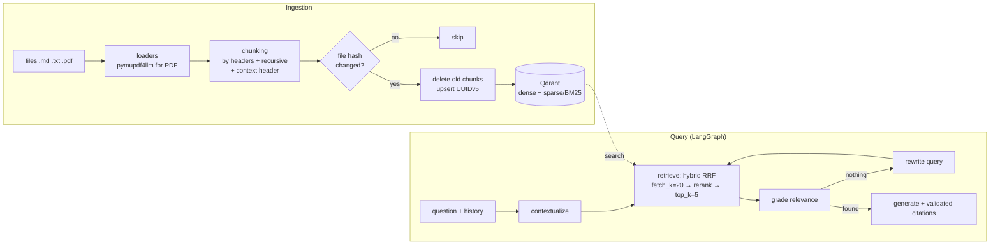

# rag-service — production-style RAG: hybrid search, reranking, corrective RAG, citations, evaluation

The service answers questions about your documents (Markdown, TXT, PDF) **based only on
the retrieved fragments**, with `[n]` references to the source/page/section; it can resolve
follow-up questions in a conversation, honestly says "not found", and retrieval quality is measured with metrics.



## Key decisions

### Ingestion: idempotency and structure
- **Idempotent ingestion** (`ingest.py`): every chunk stores the file hash in its payload.
  Re-running over the same folder costs zero embedding calls; for a changed
  file, the old chunks are deleted via a `metadata.source` filter and the new ones are inserted.
  Chunk IDs are deterministic UUIDv5, so retries are safe.
- **Structure-aware chunking** (`chunking.py`): first `MarkdownHeaderTextSplitter` (a chunk
  never mixes two sections), then `RecursiveCharacterTextSplitter` for long
  sections. Each chunk gets a **context header** prepended:
  `[Document › Section › Subsection]` — the phrase "response within 4 hours" is useless without
  context, but with context it gets found and cited
  ([Markdown header splitter](https://docs.langchain.com/oss/python/integrations/splitters/markdown_header_metadata_splitter),
  [recursive splitter](https://docs.langchain.com/oss/python/integrations/splitters/recursive_text_splitter)).
- **PDF** via `pymupdf4llm`, page by page — the page number makes it into the citation.
  Scans are better run through the `02-pdf-extractor` project, or enable `RAG_PDF_OCR`.

### Retrieval: hybrid + rerank
- **Hybrid search in Qdrant**: dense embeddings capture meaning and synonyms, sparse BM25 catches
  exact terms (`ORB-503`, plan numbers, names). The rankings are merged with
  Reciprocal Rank Fusion. The collection is created explicitly: named vectors and
  `Modifier.IDF` for sparse — Qdrant computes the corpus IDF itself
  ([Qdrant hybrid search](https://qdrant.tech/articles/hybrid-search/),
  [LangChain ↔ Qdrant](https://qdrant.tech/documentation/frameworks/langchain/)).
- **Two-stage retrieval**: broad recall (`fetch_k=20`) → cross-encoder reranker
  (`top_k=5`). A bi-encoder compares the query and the chunk independently (fast), a cross-encoder
  reads them together (accurate). The reranker and embeddings are local FastEmbed ONNX models,
  with no torch and no sending documents to a third party.
- **Multilingual**: by default `paraphrase-multilingual-MiniLM-L12-v2` and
  `jina-reranker-v2-base-multilingual` — documents in other languages
  (e.g. Ukrainian or Russian) are retrieved on par with English ones.

### Generation: corrective RAG on LangGraph (`graph.py`)
- **contextualize** — "and for Enterprise?" is turned into a standalone query using the
  conversation history (memory is a checkpointer keyed by `thread_id`); on the first turn the LLM is not called.
- **grade** — a single LLM call filters out irrelevant fragments: less noise →
  fewer hallucinations.
- **rewrite** — if nothing relevant is found, one attempt to rephrase the query.
- **generate** — an answer strictly from the fragments, with `[n]`. Citations are **validated in code**:
  references to non-existent fragments are stripped, and citation sources come from
  metadata, not from the model's text.
- **Refusal without an LLM**: if there is no context, the "not found" answer is produced by code: it's
  free and cannot hallucinate.
- **Prompt injection**: fragments are declared as data, not instructions.
- Pattern: Corrective RAG ([Yan et al., 2024](https://arxiv.org/abs/2401.15884)),
  [LangGraph agentic RAG tutorial](https://docs.langchain.com/oss/python/langgraph/agentic-rag).

### Evaluation (`evaluation.py`) — without it, any "improvement" is guesswork
- `rag eval` — **hit rate@k and MRR** over the labeled set `data/eval.jsonl`
  (question → expected document). No LLM; run it on any change to chunking,
  embeddings or the reranker.
- `rag eval --answers` — end-to-end: is the right document cited, does the answer contain
  the required facts, are there false refusals. For LLM-as-judge metrics (faithfulness,
  answer relevancy) — [RAGAS](https://docs.ragas.io/).
- Example from the tests: on the demo corpus, even with offline stub embeddings, hybrid
  search reaches MRR = 1.0 versus 0.94 for dense alone.

### Operations
- FastAPI: `POST /ask` (with `thread_id` for conversations), `POST /documents` (upload with
  file name sanitization against path traversal, an extension whitelist, a size limit),
  `GET /stats`, `GET /health`.
- Qdrant embedded (files, single process) or as a server (`docker compose up`) — one
  variable, `RAG_QDRANT_URL`.
- `RetryPolicy` on graph nodes for transient provider errors.
- All outside-world dependencies (embeddings, LLM steps, reranker) are injected —
  14 tests run without network or keys, against a real in-memory Qdrant.

## Structure

```
src/rag_service/
  config.py      # RAG_* settings
  embeddings.py  # FastEmbed dense/sparse, OpenAI via init_embeddings, offline hashing stubs
  loaders.py     # md / txt / pdf → Document with metadata
  chunking.py    # headers → recursive → context prefix
  store.py       # Qdrant: explicit collection, IDF, delete by source
  ingest.py      # idempotent ingestion
  retrieval.py   # hybrid → rerank → top_k, Chunk model
  graph.py       # corrective RAG: contextualize → retrieve → grade → rewrite → generate
  service.py     # facade for the CLI and API
  evaluation.py  # hit rate, MRR, end-to-end metrics
  api.py, cli.py
data/docs/       # demo corpus for the fictional company Orbitly
data/eval.jsonl  # 12 labeled questions
```

## Running

```bash
python -m venv .venv && source .venv/bin/activate
pip install -e ".[dev]"
cp .env.example .env                 # ANTHROPIC_API_KEY=...

rag ingest data/docs                 # the first run downloads the FastEmbed ONNX models
rag ingest data/docs                 # second run: skipped 6 — nothing is recomputed
rag eval                             # hit rate / MRR over data/eval.jsonl
rag eval --answers                   # + end-to-end answer quality (calls the LLM)
rag ask "What does error ORB-503 mean?"
rag chat                             # conversation with follow-up questions
rag serve                            # http://127.0.0.1:8000/docs

# Qdrant server + API in containers
docker compose up --build
curl -s localhost:8000/ask -H 'content-type: application/json' \
     -d '{"question":"How many free training sessions does an Enterprise customer get?"}'

pytest -q
```

Fully offline retrieval demo without downloading any models:
`RAG_EMBEDDINGS=hashing:1024 RAG_SPARSE_EMBEDDINGS=hashing rag ingest data/docs && rag eval`.

## Where to take it next
- Streaming answer tokens (SSE) via `graph.stream(stream_mode="messages")`.
- Persistent conversation memory (`PostgresSaver`) and multi-tenancy via a
  `tenant_id` filter in the Qdrant payload.
- Removing files that disappeared from the folder from the index (a `sync` mode).
- Semantic caching of frequent questions.

## Primary sources
- Qdrant hybrid search: https://qdrant.tech/articles/hybrid-search/
- LangChain + Qdrant (dense/sparse/hybrid): https://qdrant.tech/documentation/frameworks/langchain/
- LangGraph agentic RAG: https://docs.langchain.com/oss/python/langgraph/agentic-rag
- Corrective RAG (CRAG): https://arxiv.org/abs/2401.15884
- FastEmbed: https://github.com/qdrant/fastembed
- RAGAS: https://docs.ragas.io/
